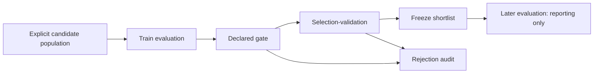

<div align="center">

# ATAR
### Algorithmic Trading Alpha Research

**Reproducible strategy research. Explicit time boundaries. Auditable computation.**

[Quickstart](docs/quickstart.md) · [Architecture](docs/architecture.md) · [Strategy implementations](docs/strategy_semantics.md) · [PinBar variants](docs/pinbar_variants.md) · [Example results](docs/demo_results.md)

Python 3.11+ · Apache-2.0 · Offline reference example · Optional VBT Pro integration

</div>

---

## The problem

A strategy backtest is only one evaluation. A research process must manage many configurations, distinguish selection data from later evaluation, preserve candidate identity, and avoid spending expensive computation on candidates already rejected.

ATAR makes those mechanics inspectable. It contains selected implementations from a larger research system, packaged with independent reference execution, explicit research contracts, and small reproducible examples. It is not a turnkey trading system or a claim of persistent alpha.

## A useful starting point

| Your task | Reusable component | Start here |
|---|---|---|
| Evaluate many configurations without losing lineage | Versioned candidate IDs and content-addressed results | [`identity.py`](src/atar/identity.py), [`artifacts.py`](src/atar/artifacts.py) |
| Reduce later-stage work without changing a fixed research decision | Eager/progressive evaluation with audited rejection reasons | [`pipeline.py`](src/atar/pipeline.py), [worked example](docs/staged_evaluation.md) |
| Sample an oversized candidate table without ranking by past returns | Deterministic nearest-row Latin-hypercube coverage | [`sampling.py`](src/atar/sampling.py), [sampling example](examples/sampling.py) |
| Investigate signal implementations and their differences | Five strategy families, vectorized and serialized PinBar paths | [strategy guide](docs/strategy_semantics.md) |
| Review software reliability rather than a performance screenshot | Boundary tests, cache checks, next-bar fills and reproducible artifacts | [`tests/`](tests), [verification notes](docs/verification.md) |

## Research flow



**Selection-validation is not an untouched final test.** Once a period helps select candidates, a later, separate interval is needed to inspect the frozen decision. The example keeps that distinction explicit. It does not claim to remove all selection bias.

## Run the example

From the repository root, with Python 3.11 or newer:

```bash
python -m venv .venv
source .venv/bin/activate
python -m pip install -e ".[dev]"
python -m atar demo --config examples/staged_research/demo.json --output artifacts/demo
python -m pytest -q
```

On Windows, activate with `.venv\Scripts\activate` instead. Open `artifacts/demo/report.html` in a browser. The reference demo runs locally and needs no market-data service, account, credentials or VBT Pro installation.

The example compares the **same 24 candidates, data, execution model and gates** through eager and progressive paths. A local cold run required **48 versus 35 selection evaluations**, with identical 11-candidate shortlists. That is **13 avoided evaluations**, not a promised wall-time speedup or evidence of profit. [Read the measured result and limitations.](docs/demo_results.md)

Generated files include a configuration and data fingerprint, per-candidate decisions, measured evaluation counts, a frozen shortlist, final-period results, a PinBar signal comparison and a standalone HTML report. Negative outcomes and empty shortlists are retained.

## Five families, distinct implementations

**PinBarEMARSI · RainbowEMA · BillWilliams · TrendScore · R3**

The examples combine candle geometry, stateful indicator conditions, EMA ribbons, confirmed fractals, composite trend scores and RSI streaks. They demonstrate heterogeneous signals behind a shared research interface. They are not advertised as the current best-performing or deployed configurations.

PinBarEMARSI includes **both vectorized and IH-derived serialized logic**. The original minute-aligned VBT Pro entry-point adaptation is also included, along with a standalone IH quote-callback adapter. These implementations are intentionally not forced into exact equivalence.

The author reports approximately **80% signal overlap in prior research**. That observation is context-dependent and is not a benchmark reproduced or guaranteed by this release. Signal overlap also does not imply identical fills or P&L. The included comparison reports exact timestamp-and-direction overlap on its own synthetic input, excluding non-signal bars. [Implementation differences and runnable entry points.](docs/pinbar_variants.md)

## Design choices worth inspecting

Candidate identity is separated from result identity. Evaluation windows are half-open and timezone-aware. Signals use completed bars and the reference simulator fills no earlier than the next bar. Gates have explicit inputs and reject undefined active metrics. Cache records verify their context and result hash. A completion marker is written only after the experiment artifacts are assembled. No broker or deployment code is executed.

The source has been adapted into standalone public interfaces. New reference code is identified as such. Neither the reference backend nor a test double is presented as the private IH execution engine.

## Reading path

Start with the [quickstart](docs/quickstart.md), then follow **problem → mechanism → example → tests → limitations** in the [architecture](docs/architecture.md) and [staged-evaluation note](docs/staged_evaluation.md). The [extension guide](docs/extending.md) shows how to supply a strategy or evaluation backend. The [Slurm example](examples/slurm/demo_array.sh) runs independent public experiments without site-specific infrastructure.

The [limitations](docs/limitations.md) describe what the reference simulator does not model. The [verification record](docs/verification.md) distinguishes tests executed for this review build from optional licensed-runtime checks.

## Scope and ownership

ATAR is an independent publication with its own history. It does not distribute operational accounts, current selection presets, deployment inventories, private market data or a production portfolio recipe. The research interfaces are venue-neutral, but real instruments still need appropriate calendars, costs, adjustment conventions and execution validation.

Developed by **Yingrui Shang / ZiyaTech**. Contributions are welcome around reproducibility, validation, documentation and independently testable adapters. See [CONTRIBUTING](CONTRIBUTING.md).

The released code is licensed under [Apache-2.0](LICENSE). VBT Pro is an optional, separately installed dependency and is not redistributed. See [third-party notices](THIRD_PARTY_NOTICES.md).
