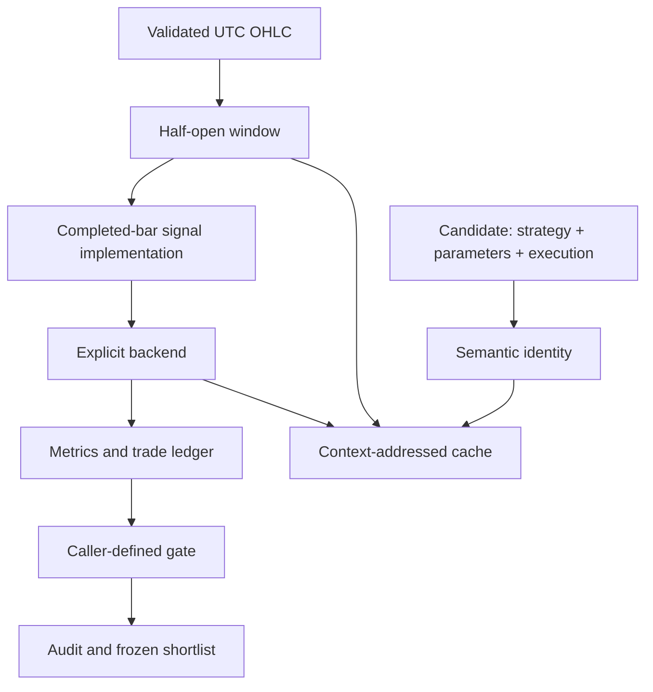

# Architecture: explicit contracts, small replaceable parts

## Why these boundaries exist

A research result is difficult to trust when it is unclear which parameter row, data snapshot, software version and evaluation period produced it. ATAR separates those responsibilities instead of hiding them in a single backtest launcher.

## Module contracts

`identity.py` canonicalizes JSON-like parameters without allowing parameter keys to replace identity metadata. Public candidate IDs are independent of any external trading registry. Cache identity additionally depends on data, software, backend, execution settings and window.

`temporal.py` validates ordered, unique, timezone-aware, regularly spaced OHLC data. Windows are `[start, end)`. Resampling drops incomplete aggregates. The reference model deliberately rejects gaps rather than silently manufacturing prices.

`strategies/` returns long/short close-time decisions on the exact bar index. `backends/reference.py` owns execution. It converts a prior completed-bar decision into a next-open fill, resolves exits, charges explicit costs and returns a trade ledger. Strategy logic does not call a broker.

`pipeline.py` owns only routing and selection. The eager and progressive paths use identical candidates and gates. A reporting-only function evaluates the already frozen shortlist on the final interval.

`artifacts.py` makes files individually atomic and cache entries integrity-checked. The overall experiment uses a single-writer lock and a completion marker. This is not a distributed transaction or a distributed lock.

## Intentionally separate PinBar APIs

The core package's decisions are close-time masks. The optional original VBT integration produces minute-indexed executable-time masks. The IH integration consumes quote timestamps and produces order intents from the previous completed bar. These timestamp conventions are documented rather than silently merged.

## What is new versus extracted

The five formulas and IH PinBar decision helpers are adapted from author-owned implementations. Source coupling to private loaders and operations has been removed. The reference indicator provider, reference OHLC simulator, standalone API, reports and synthetic example are publication-native code. They are not represented as the private simulation or trading system.

The release focuses on independent candidates. Shared-capital portfolios, interdependent candidate execution and production portfolio construction need different contracts and are outside this release.
